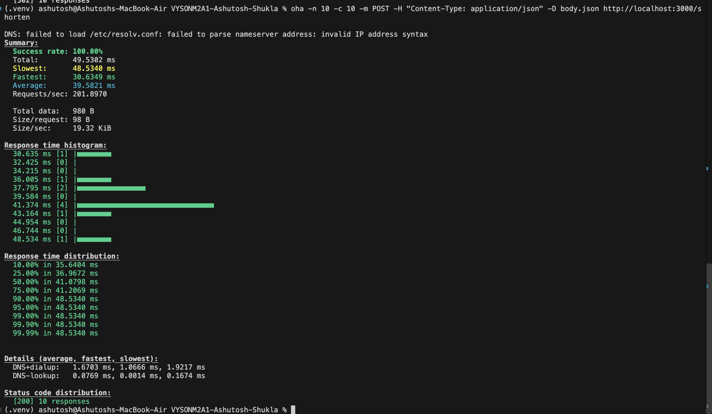
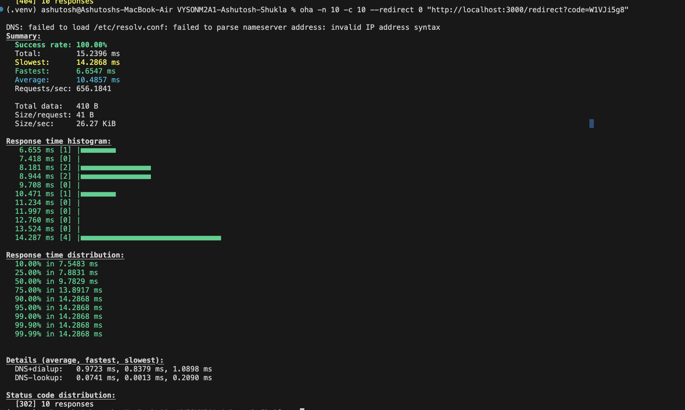
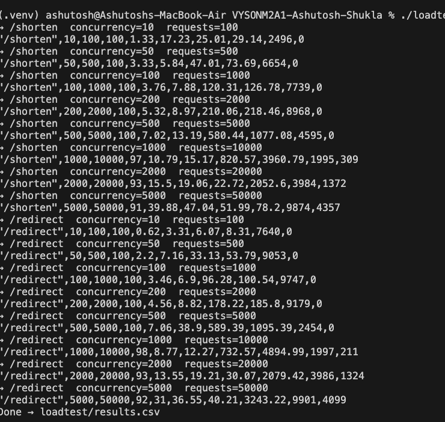
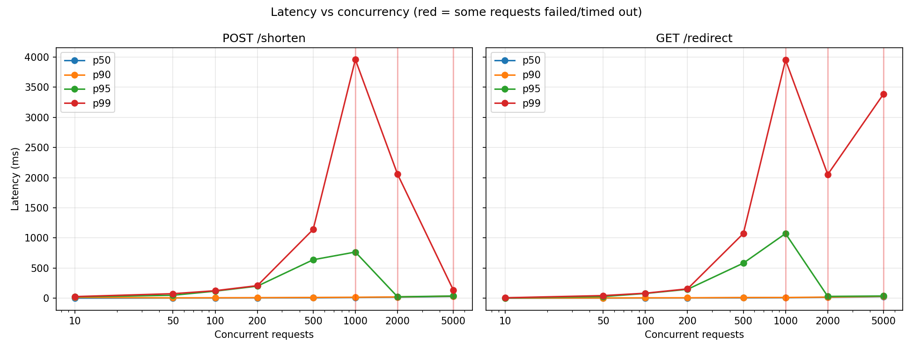

# VYSON M2A1 — Solution

**Stack:** Node.js 22+, Express 5, SQLite (built-in `node:sqlite`)

| Question | Status | Where to look |
| -------- | ------ | ------------- |
| Q1: `POST /shorten` and `GET /redirect` | Done | [`src/`](src/) |
| Q2: Integration test | Done, passing | [`test/integration.test.js`](test/integration.test.js) |
| Q3: Load test (10 concurrent requests) | Done | [Q3 section below](#q3-load-test) and [`screenshots/`](screenshots/) |
| Q4: Find the breaking point (10 → 5000 concurrent) | Done | [Q4 section below](#q4-finding-the-breaking-point) and [`loadtest/`](loadtest/) |

Quick start:
---

## Q1: Endpoints

> Create the following two endpoints:
> 1. `POST /shorten` accepts a long URL and returns a short code
> 2. `GET /redirect?code={code}` redirects to the original URL


### `GET /redirect?code={code}`

```bash
curl -i "http://localhost:3000/redirect?code=W1VJi5g8"
# HTTP/1.1 302 Found
# Location: https://example.com
```

### Code structure

Database table `url_shortner`:

| Column | Type | Notes |
| ------ | ---- | ----- |
| `id` | INTEGER | primary key, autoincrement |
| `original_url` | TEXT | not null |
| `short_code` | TEXT | not null, unique |
| `created_at` | TEXT | ISO-8601, defaults to now |

---

## Q2: Integration test

> Call `/shorten` with `https://example.com`, store the short code in a variable, then call `/redirect` with that code and check that the redirection happens correctly.

File: [`test/integration.test.js`](test/integration.test.js)

Run it with `npm test`:

```
✔ shortening a URL and following its code redirects to the original (48.81ms)
ℹ tests 1
ℹ pass 1
ℹ fail 0
```

---

## Q3: Load test

> Send 10 simultaneous requests to both endpoints, one at a time. Share screenshots and find the p50, p90, p95 and p99 values.

Both endpoints were tested with **[oha](https://github.com/hatoo/oha)**. Each run sent 10 requests in total, all 10 at the same time (`-n 10 -c 10`). The endpoints were tested one after the other against a local server started with `npm start`.

### Results

| Endpoint | p50 | p90 | p95 | p99 | Success rate | Status codes |
| -------- | --- | --- | --- | --- | ------------ | ------------ |
| `POST /shorten` | 41.08 ms | 48.53 ms | 48.53 ms | 48.53 ms | 100% | 10 × `200` |
| `GET /redirect` | 9.78 ms | 14.29 ms | 14.29 ms | 14.29 ms | 100% | 10 × `302` |

### Commands

```bash
# body.json contains {"url":"https://example.com"}
oha -n 10 -c 10 -m POST -H "Content-Type: application/json" -D body.json http://localhost:3000/shorten
oha -n 10 -c 10 --redirect 0 "http://localhost:3000/redirect?code=W1VJi5g8"
```

`--redirect 0` makes oha record the `302` itself instead of following it to `example.com`, so only our server's time is measured.

### Screenshots

**`POST /shorten`**



oha sent 10 POST requests to `/shorten` at the same time, and all of them succeeded (Success rate 100%).
The "Response time distribution" block gives the percentiles: p50 is 41.08 ms, and p90, p95 and p99 are all 48.53 ms because with 10 requests they land on the slowest one.
The histogram shows most requests finished between 36 and 43 ms.
"Status code distribution" shows 10 × `200`, because `https://example.com` was already shortened and the existing code was returned.

**`GET /redirect`**



oha sent 10 GET requests to `/redirect?code=W1VJi5g8` at the same time, with `--redirect 0` so it did not follow the redirect.
All 10 succeeded: p50 is 9.78 ms, and p90, p95 and p99 are 14.29 ms.
Requests per second (656) is about 3× higher than for `/shorten`, because a redirect only reads from the database.
"Status code distribution" shows 10 × `302`, which confirms every request was redirected correctly.

### Observations

- **All 20 requests succeeded.** Success rate was 100% on both endpoints.
- **p90, p95 and p99 are the same value.** With only 10 requests, each of those percentiles lands on the single slowest request.
- **`/redirect` is faster than `/shorten`.** A redirect is one indexed `SELECT`. A shorten does a lookup and then an `INSERT`, which writes to disk.
- **`/shorten` returned `200`, not `201`.** `https://example.com` had already been shortened, so every request returned the existing code (the idempotent path) instead of creating a new row.

---

## Q4: Finding the breaking point

> Keep increasing the traffic to see where it breaks (i.e. the requests start getting timed out). Increase concurrent API calls to 50, 100, 200, 500, 1000, and so on. Find p50, p90, p95, p99 for all loads. Plot a latency graph and observe how response times change.

### How it was tested

[`loadtest/run.sh`](loadtest/run.sh) runs oha against each endpoint at increasing concurrency: **10, 50, 100, 200, 500, 1000, 2000 and 5000**.

- Each level sends `concurrency × 10` requests, so every connection makes 10 requests and each level gets a fair sample.
- `-t 5s` sets a timeout: any request that takes longer than 5 seconds counts as **timed out**.
- The script waits 3 seconds between levels so the server can settle.
- Results go to [`loadtest/results.csv`](loadtest/results.csv), and [`loadtest/plot.py`](loadtest/plot.py) draws the graph.

```bash
npm start                                  # terminal 1
./loadtest/run.sh W1VJi5g8                 # terminal 2 (pass any existing short code)
python3 loadtest/plot.py                   # needs matplotlib
```



This is the terminal output of `run.sh`, which runs oha once per concurrency level, first for `/shorten` and then for `/redirect`.
Each `→` line names the level being tested, and the line below it is the CSV row saved for that level.
The columns are: endpoint, concurrency, requests, success %, p50, p90, p95, p99 (ms), requests/sec and errors.
Up to 500 concurrent requests success stays at 100 with 0 errors. From 1000 upward, success drops below 100 and errors appear, which is the breaking point.

### Results: `POST /shorten`

| Concurrency | Requests | Success | p50 | p90 | p95 | p99 | Req/sec | Errors |
| ----------: | -------: | ------: | --: | --: | --: | --: | ------: | -----: |
| 10 | 100 | 100% | 1.28 ms | 14.47 ms | 22.41 ms | 26.76 ms | 2,664 | 0 |
| 50 | 500 | 100% | 3.18 ms | 5.97 ms | 48.71 ms | 74.82 ms | 6,559 | 0 |
| 100 | 1,000 | 100% | 3.43 ms | 7.24 ms | 116.97 ms | 124.26 ms | 7,909 | 0 |
| 200 | 2,000 | 100% | 5.06 ms | 8.79 ms | 199.81 ms | 208.42 ms | 9,263 | 0 |
| 500 | 5,000 | 100% | 6.73 ms | 12.65 ms | 637.83 ms | 1,141.18 ms | 2,401 | 0 |
| **1000** | 10,000 | **97%** | 11.69 ms | 15.80 ms | 766.01 ms | 3,959.76 ms | 1,995 | **278** |
| 2000 | 20,000 | 94% | 17.05 ms | 20.70 ms | 23.15 ms | 2,056.92 ms | 3,982 | 1,294 |
| 5000 | 50,000 | 91% | 28.78 ms | 33.80 ms | 36.56 ms | 134.50 ms | 9,875 | 4,470 |

### Results: `GET /redirect`

| Concurrency | Requests | Success | p50 | p90 | p95 | p99 | Req/sec | Errors |
| ----------: | -------: | ------: | --: | --: | --: | --: | ------: | -----: |
| 10 | 100 | 100% | 0.66 ms | 2.88 ms | 5.00 ms | 7.06 ms | 8,402 | 0 |
| 50 | 500 | 100% | 1.87 ms | 3.67 ms | 27.10 ms | 43.31 ms | 11,242 | 0 |
| 100 | 1,000 | 100% | 2.97 ms | 6.34 ms | 78.56 ms | 82.74 ms | 11,814 | 0 |
| 200 | 2,000 | 100% | 4.21 ms | 6.96 ms | 147.43 ms | 155.08 ms | 12,633 | 0 |
| 500 | 5,000 | 100% | 5.79 ms | 11.54 ms | 581.53 ms | 1,073.08 ms | 2,468 | 0 |
| **1000** | 10,000 | **98%** | 8.47 ms | 12.04 ms | 1,072.72 ms | 3,952.40 ms | 1,996 | **211** |
| 2000 | 20,000 | 93% | 14.53 ms | 18.24 ms | 29.85 ms | 2,052.75 ms | 3,983 | 1,326 |
| 5000 | 50,000 | 92% | 26.29 ms | 31.03 ms | 36.34 ms | 3,388.90 ms | 9,884 | 4,132 |

### Latency graph

The x-axis is concurrency on a log scale. Red vertical lines mark the levels where some requests failed or timed out.



p50 and p90 (blue and orange) stay close to zero at every level, so the typical request is always fast, even under heavy load.
p95 and p99 (green and red) climb steadily from 200 concurrent requests and peak at 1000, where p99 reaches about 4 seconds on both endpoints.
The red vertical lines at 1000, 2000 and 5000 mark where requests started timing out, so the server breaks at about 1000 concurrent requests.
The drop in p99 after 1000 does not mean the server recovered: requests that timed out are left out of the percentiles, so only the faster ones are counted.


[Q5] Usually, we don’t write raw SQL queries in the backend app. Can you find out why?


1 - Security Reason : Risk of sql injection 
        // DANGEROUS: raw SQL built with string concatenation
        db.exec(`SELECT * FROM url_shortner WHERE short_code = '${code}'`);
        // If code = "x'; DROP TABLE url_shortner; --", the table is deleted

2 - Migrations : ORM's come with migration tools ,that track schema changes as versioned files 

3 - Switching databases : SQL differs sliightly between database , SQLite , Postgres , and mysql 
   each have  their own syntax .An ORM generates the right SQL for whichever database you use, so moving from SQLite to PostgreSQL means changing a config setting, not rewriting every query

4 - Maintainability : SQL inside strings is just text, a typo in a column name only shows up at runtime .
                      Finding the column is easy in ORM


