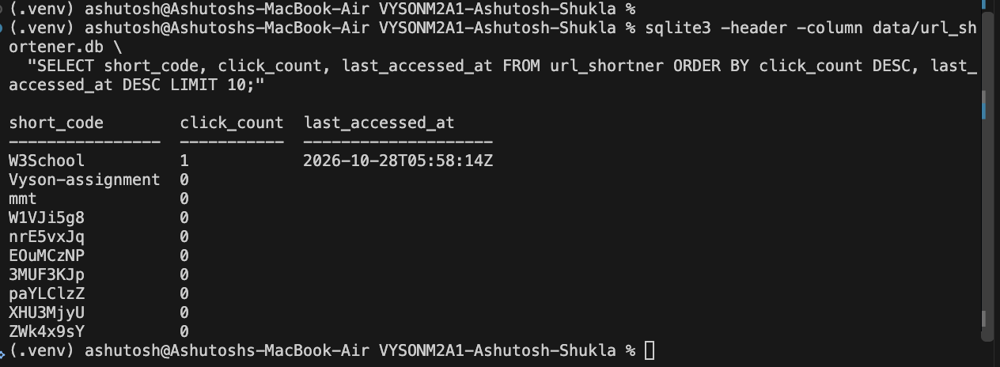
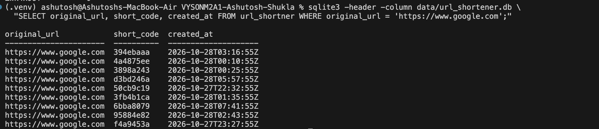
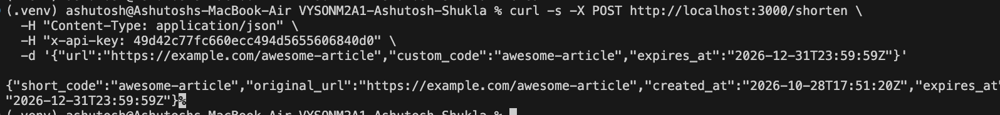
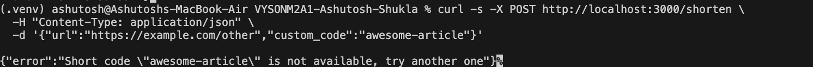
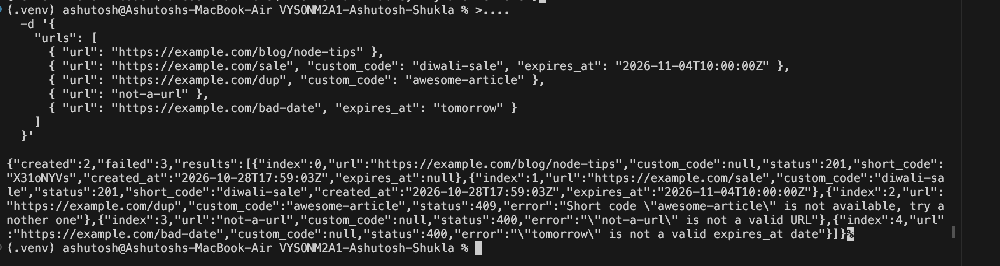
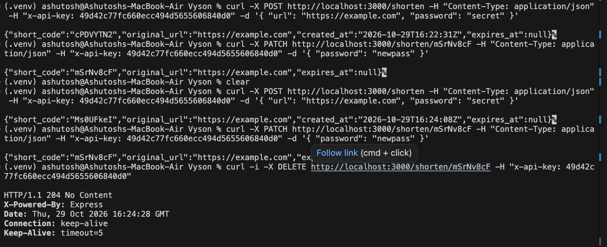

## Q1

> Write a SQL query to find the last 10 URLs which were shortened. How would you handle the latter case of sharing the analytics real-time?

### Last 10 shortened URLs

```sql
SELECT short_code, original_url, created_at
FROM url_shortner
ORDER BY created_at DESC, id DESC
LIMIT 10;
```

### Sharing the analytics in real time

There are few ways to do it ,

- For small user base we can create an end point `/latest` , that can be called from dashboad by the user , user can see latest web url that has been shortend .
- We can reddis cache for better user expirience and faster response

  suppose one user call that api and got the res then that resposne can be stored in cache , and multiple can access the same result and avoid the db call latency.

---

## Q2

> [Q2] When an empty URL is sent in the request, return an error message along with an appropriate http status code. Add this as a test case as well.

Already handled that condition if url not present , send res 400 **(400)**

Added the test case .

---

## Q3

> [Q3] When the `/redirect` endpoint is called, increment a counter in a new column in the `url_shortener` table. This will let us know how many times a particular short code has been viewed. In yet another column, keep a track of last access time for each URL as well, i.e. set it to current timestamp whenever the short code is accessed via the `/redirect` endpoint. Write a SQL query to show the 10 most popular short codes, i.e. the top URLs with the most number of clicks. Break ties by `last_accessed_at`.

### Added column



- When user redirect , increasing the count by 1 each time
- `last_accessed_at` - timestamp when any user visit any url

### Query

```sql
SELECT short_code, click_count, last_accessed_at
FROM url_shortner
ORDER BY click_count DESC, last_accessed_at DESC
LIMIT 10;
```

- `desc` from `click_count` will return 10 most accessed url with the time when last visited
- `desc` with `last_accessed_at` will break ties

### Changes maded in api as well

check this below function

src/models/url.sequelize.model.js recordVisit(code) Runs click_count = click_count + 1 and sets last_accessed_at to now in one UPDATE, then returns the row (or null if the code does not exist)

---

## Q4

> [Q4] Allow multiple short codes for the same URL. Write a SQL query to show the top 10 URLs being shortened. The output would contain a list of rows where each row would have a URL along with the number of times it has been shortened.

### Allowing multiple short codes

The table never had a `UNIQUE` constraint on `original_url`; only the API returned the old code for a repeated URL. That check is removed, so every `POST /shorten` now creates a new row with a new short code.

Now after the changes
It will not look into the existing row , It will always create new row
it will always return 201 not sometime 200
### Dummy records
Added sone dummy record into table , it contains 44 record now

### Top 10 URLs being shortened

```sql
SELECT original_url, COUNT(*) AS times_shortened
FROM url_shortner
GROUP BY original_url
ORDER BY times_shortened DESC, original_url
LIMIT 10;
```

- `GROUP BY original_url` puts all short codes of the same URL in one group
- `COUNT(*)` gives how many times that URL has been shortened
- `ORDER BY times_shortened DESC` puts the most shortened first, `original_url` breaks ties

### Solution




[Q5] The easiest way to support this is by adding API keys. You’ll need to make a lot of changes in a lot of places for this.


this is the table i created
CREATE TABLE `users` (
  `id`         INTEGER  PRIMARY KEY AUTOINCREMENT,
  `email`      TEXT     NOT NULL UNIQUE,
  `name`       TEXT,
  `api_key`    TEXT     NOT NULL UNIQUE,
  `created_at` DATETIME NOT NULL DEFAULT CURRENT_TIMESTAMP
);
Added these record
id  email              name   api_key                           created_at         
--  -----------------  -----  --------------------------------  -------------------
1   alice@example.com  Alice  49d42c77fc660ecc494d5655606840d0  2026-10-28 09:42:06
2   bob@example.com    Bob    fa38583164ea4f5d7f8d26dcc7db12c5  2026-10-28 09:42:06
3   carol@example.com  Carol  3352ba44b10df4010df387bc102716c1  2026-10-28 09:42:06
(.venv) ashutosh@Ashutoshs-MacBook-Air VYSONM2A1-Ashutosh-Shukla % 

Added foreign key in url_shortner 

user.sequelize.model.js: new findByApiKey(apiKey), which returns the matching user or null.
url.sequelize.model.js: shorten(originalUrl, userId) now saves user_id.
url.controller.js:
shorten() reads the x-api-key header and passes the user's id.
remove() returns 404 if the code doesn't exist and 403 if the caller isn't the owner, then deletes.


Why not the URL (/shorten?api_key=...)

When the browser leaves the page, the URL can be sent to the next site in the Referer header.So a key in the URL leaks easily, and anyone who sees the URL can use the key.


Showing key URL is not , it can be accessed ,so we can not send it in query


Why not the body ({ "url": "...", "api_key": "..." })

GET and DELETE requests normally have no body, so the key would only work on POST. Our delete endpoint needs the key too.


Why the header (x-api-key: ...)

Headers are the standard place for credentials, like Authorization or x-api-key.
They are usually not logged or cached, and they don't show up in browser history.
The same header works on every endpoint and every method.


[Q6] What are the issues with using API keys?

If key can leak , whoever find that can do some action like create or delete and server can't tell the difference

it never expire so a stolen key work next year also until we change it .

Changing the key is a hassle , user need to update it in app that uses it

There is no password check or login , it proves who sent the request not who the person is

## Q7

> [Q7] List down as many more ways to manage users as you can find.

There are many ways

### Authentication (who you are)

There are multiple ways to login

- Using username and password with session
- Login with **JWT token** => after login the user gets a token, which is sent with every request to prove who they are
- **Oauth2.0** - login via google , faceboook, linkedIn, amazon etc
- **SSO** : sed by companies: one company login works for every tool, such as Slack, Jira and email. When an employee leaves, one account is disabled everywhere.
- **OTP** with mobile number or email
- **Passkeys**: user logs with a fingerprint

We can make login stronger using

- **2FA / MFA**

### Authorization (what you can do)

- **RBAC** (Role-Based Access Control). Each user has a role such as admin or viewer, and the role decides what they can do.
- **ABAC** (Attribute-Based Access Control). Rules are based on details such as "the owner can delete" or "only users from India".
- **Scopes / permissions on tokens.** A token says what it may do, such as `urls:create` or `urls:delete`. This fixes the Q6 problem of one key being able to do everything.


[Q8] Add an expiry date field to the URLs. Modify the API to accept optional expiry date during creation. Write tests to verify expired URLs return appropriate error codes.


Expiry date field: url_shortner has a new expires_at column.
Expired links: /redirect returns 410 Gone once a link has expired.
Tests: an expired link returns 410, and a link that hasn't expired yet still redirects.

Files and functions changed:

- `src/models/url.sequelize.model.js`: added `expires_at` column, new `isExpired(row)` and `toIsoText(date)`, `shorten()` now takes `expiresAt`
- `src/controllers/url.controller.js`: new `parseExpiresAt(value)`, `shorten()` reads `expires_at` from body, `redirect()` returns 410 if expired
- `test/integration.test.js`: 2 new tests for expired and not-expired links

### Screenshots

Created a short code with `expires_at`, the response returns the saved expiry date.



Same custom code sent again, it is rejected as not available.




[Q9] In the /shorten API endpoint, allow an optional parameter to set the custom code as requested by the user (e.g., user wants https://short.ly/awesome-article). Add tests as well.

Added custom code and test

Files and functions changed:

- `src/models/url.sequelize.model.js`: `shorten()` now takes `customCode`, uses it instead of a random code and returns `null` if it is taken
- `src/controllers/url.controller.js`: `shorten()` reads `custom_code` from body, returns 409 if the code is not available
- `test/integration.test.js`: 2 new tests for a free custom code and a taken one (409)


## Q10

> [Q10] Would you handle bulk creation in the /shorten endpoint itself or create a new batch endpoint that can shorten multiple URLs in one request? Think about the pros and cons. How would error handling work in both cases? Share them along with your final choice. Implement it.

### Final choice

A new batch endpoint: `POST /shorten/batch`. `/shorten` stays as it is for one URL.

- All URLs are shortened together with `Promise.allSettled`, so one bad URL does not stop the others.
- Limit of **100 URLs** per request.

### Pros

- 100 URLs take one request instead of 100 requests, which saves network time.
- Easier for the client.
- One response gives the whole picture: which URLs succeeded, which failed and why.

### Cons

- Heavier on the server.
- Slower individual response, the client waits for the whole batch.
- Harder to maintain: when many users call the bulk endpoint the server can get overloaded, and if the request fails midway and is retried, duplicate records can be created, which needs handling as well.
- Many more test cases can arise.

### Error handling

- **Inside `/shorten` itself:** one status code has to describe the whole request, so either one bad URL fails everything, or the same endpoint returns two different response shapes (single and list).
- **Separate batch endpoint (chosen):**
  - Whole request is wrong (`urls` missing, empty or more than 100) → `400`.
  - Every URL created → `201`.
  - Some URLs failed → `207 Multi-Status`, each result has its own `status` and `error` (`400` invalid URL or date, `409` custom code taken).

Files and functions changed:

- `src/controllers/url.controller.js`: new `shortenBatch()` with `MAX_BATCH_SIZE = 100`
- `src/routes/index.js`: new route `POST /shorten/batch`
- `test/integration.test.js`: 1 new test for a mixed batch (207 with one created, one 409 and one 400)

### Screenshots

Batch of 5 URLs: 2 created, a taken custom code (409), an invalid URL (400) and an invalid expiry date (400).




[Q11] Find out the difference between authentication and authorization.

Authentication -

When user login with credential to any application .it check who you are.

Authorization -

Loggen In user can access the webpage ,it check what user is allowed to do .

once user tried to login with creadential on gmain if he successfully authenticated he is authorized to read , delete or send the email.


[Q12] There are two tiers now:

1. “hobby” - the one that the user is assigned by default
2. “enterprise” - new tier that supports bulk creation, client will share the details of the user who has moved to this tier and you can mark it in the users table manually for some time before automating this workflow

Modify the bulk creation flow to check if the user is on the “enterprise” tier before moving further. Add tests as well.


Added two tier 

Only enterprize tier should have access to bulk feature

Files and functions changed:

- `src/models/user.sequelize.model.js`: new `tier` column (default `hobby`), added to existing `users` tables on startup
- `src/controllers/url.controller.js`: `shortenBatch()` returns 403 if the user is not on the `enterprise` tier
- `test/integration.test.js`: new enterprise user `carol`, the batch test now sends her api key


[Q13] Allow edit requests on short codes. Add tests as well.

A future time, or null, makes it active again.

Only the owner can edit, the same rule as delete. Anyone else gets a 403.
A missing expires_at or a bad date returns 400, and an unknown code returns 404.

Files changed:

src/routes/index.js: new PATCH /shorten/:code route.
src/controllers/url.controller.js: new update() function.
src/models/url.sequelize.model.js: new updateExpiresAt() function.
test/integration.test.js: two new tests.
The owner makes a code inactive (410), then active again (302).
Another user trying to edit gets a 403 and the code stays unchanged.

### Screenshots

Alice's short code `igdjmyIJ` is edited with `PATCH /shorten/igdjmyIJ`:

1. `expires_at` set to a past date (2020-01-01), so the code is now inactive.
2. `/redirect` returns **410 Gone** with "Short code has expired".
3. `expires_at` set back to `null`, so the code is active again.
4. `/redirect` returns **302 Found** to `https://example.com`.


[Q14] Support adding a password on the short code while creating and editing them. The /redirect endpoint should also take in this optional parameter to decide whether to show the original URL or return an error.

Added the changes 

### Screenshots

1. `POST /shorten` with `"password": "secret"` creates the short code.
2. `PATCH /shorten/mSrNv8cF` with `"password": "newpass"` changes the password.




[Q15] Support this feature of showing a list of all URLs of a user.


New endpoint `GET /urls` lists every short code of the user from the `x-api-key` header. All fields are shown except `password_hash` (only `has_password`). The list is paged with `?page=` and `?limit=` (default 100, max 1000).

Files changed:

src/routes/index.js: new GET /urls route.
src/controllers/url.controller.js: new list() function.
src/models/url.sequelize.model.js: new listByUser() function.
test/integration.test.js: one new test, a user lists their codes page by page.

### Curl

```
curl "http://localhost:3000/urls?page=1&limit=5" -H "x-api-key: 49d42c77fc660ecc494d5655606840d0"
```

### Screenshots

Page 1 with `limit=5` returns 5 of the user's 7 short codes (`total: 7`).


