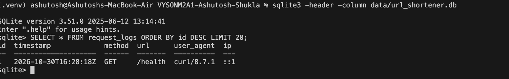
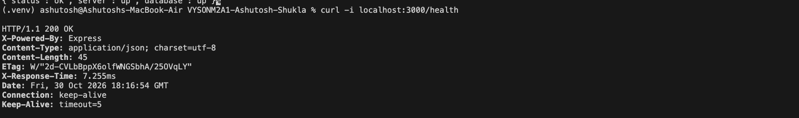

As codebase increasing , I have added schema and service layer , Optimize the cod and changes the folder structure

---

## Q1

> [Q1] Create a middleware that logs the following details on every request:
>
> 1. Timestamp
> 2. HTTP method and URL
> 3. User-Agent
> 4. IP
>
> Save the logs in a file or a database table.

Logs are saved in a new `request_logs` table (a file would be lost on Vercel, its disk is temporary).

### Query

```sql
SELECT * FROM request_logs ORDER BY id DESC LIMIT 20;
```



### Files changed

- `src/schemas/requestLog.schema.js`: new `request_logs` table (`id`, `timestamp`, `method`, `url`, `user_agent`, `ip`)
- `src/schemas/index.js`: creates `request_logs` on startup
- `src/models/requestLog.model.js`: new `insert()` query
- `src/services/requestLog.service.js`: new `logRequest()`, adds the timestamp and saves the row
- `src/middleware/requestLogger.js`: new middleware, reads method, `originalUrl`, User-Agent and IP from the request
- `src/app.js`: `requestLogger` added as the first middleware, so every request is logged (even bad JSON and unknown routes); `trust proxy` set so the real visitor IP is logged on Vercel

---

## Q2

> [Q2] What if we only want to run the above for some routes?

### 1st way

If we want to requestlof for only specific routes , then pass in the routes only .

```js
router.post('/shorten', requestLogger, controller.shorten);
```

### 2nd way

2nd way to use it like

```js
app.use(['/shorten', '/redirect'], requestLogger); // /shorten, /shorten/batch, /shorten/:code, /redirect
```

---

## Q3

> [Q3] Create a middleware that checks whether the provided API key is valid or not. If not, return the request at this step itself without running the endpoint logic.

### Files changed

- `src/middleware/requireApiKey.js`: new middleware, returns `401` if the `x-api-key` header is missing or invalid, so the controller never runs; otherwise sets `req.user` and calls `next()`
- `src/services/user.service.js`: new `findByApiKey()`, used by the middleware to look up the user
- `src/routes/index.js`: `requireApiKey` added to `POST /shorten/batch`, `PATCH /shorten/:code`, `DELETE /shorten/:code` and `GET /urls`
- `test/integration.test.js`: deleting without an api key now expects `401` instead of `403`; deleting a code that does not exist now sends a valid api key, so it still gets `404`

---

## Q4

> [Q4] In the bulk endpoint, move the authorization logic to a middleware (that checks if the plan is enterprise or not). This makes it reusable for future.

### Files changed

- `src/middleware/requireEnterprise.js`: new middleware, returns `403` unless `req.user.tier` is `enterprise`; runs after `requireApiKey`, which sets `req.user`
- `src/routes/index.js`: `POST /shorten/batch` now uses `requireApiKey, requireEnterprise`; any future enterprise-only route can use the same two middlewares
- `src/services/url.service.js`: removed the enterprise tier check from `shortenBatch()`

---

## Q5

> [Q5] Create a blacklist middleware that checks the API key from a config file where we can define a list of notorious user keys to be blocked. This file can be read at runtime (i.e. not static in code).

### Files changed

- `config/blacklist.json`: new config file, keys listed in `blockedApiKeys` are blocked
- `src/services/blacklist.service.js`: new `isBlocked()`, reads `config/blacklist.json` on every request, so a key added to the file is blocked without restarting the server
- `src/middleware/blacklist.js`: new middleware, returns `403` if the `x-api-key` is in the blacklist, so the endpoint never runs
- `src/app.js`: `blacklist` added after `requestLogger` (blocked requests are still logged) and before the routes, so it checks every endpoint

---

## Q6

> [Q6] Store the start time when the request is passing through this new middleware. While coming back, see the end time and calculate the difference as the elapsed time. Add this to the response header.

### Idea

It works like a stopwatch: note the time when the request comes in, note the time again just before the response goes out, and subtract.

It gives the **total** time of the request (all middleware + route together), not the time of each middleware separately.

### Steps

1. `responseTime` is the first middleware, so it runs first. It saves the start time: `start = 1000`.
2. It replaces `res.writeHead` with its own function. This function does not run yet; it waits.
3. It calls `next()`. `responseTime` is now finished.
4. `requestLogger`, `blacklist`, `express.json()` and the route run one by one. They do nothing with the time; time just passes.
5. The controller sends the response with `res.json()`. Before sending, Node always calls `res.writeHead()` to send the headers.
6. `res.writeHead` is now our function from step 2, so it runs: end time `1001.6`, elapsed = `1001.6 - 1000` = `1.6 ms`.
7. It adds the header `X-Response-Time: 1.600ms`, then sends the response.

The function from step 2 still remembers `start`, even though `responseTime` has finished (a JavaScript closure).

`res.on('finish')` is not used because it runs after the headers are already sent, so it is too late to add a header.

### Example

```bash
curl -i localhost:3000/health
```



### Files changed

- `src/middleware/responseTime.js`: new middleware, saves the start time and adds the `X-Response-Time` header just before the response is sent
- `src/app.js`: `responseTime` added as the first middleware, so the time covers every other middleware and the route